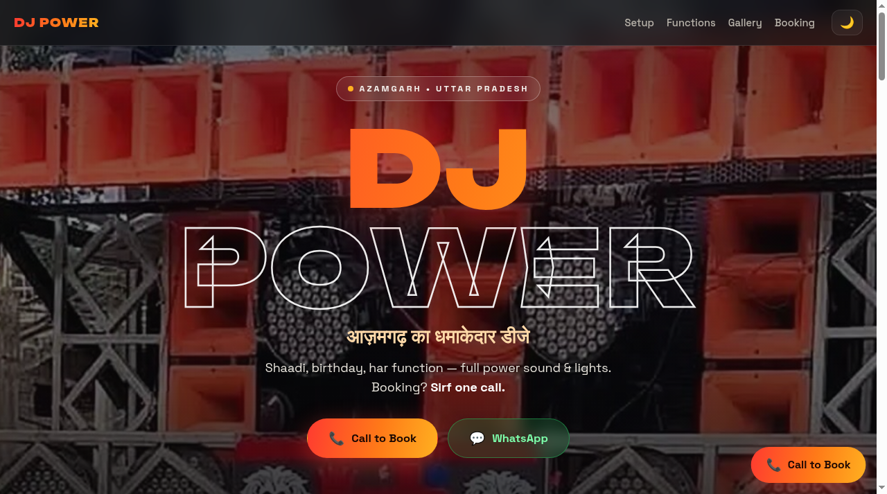
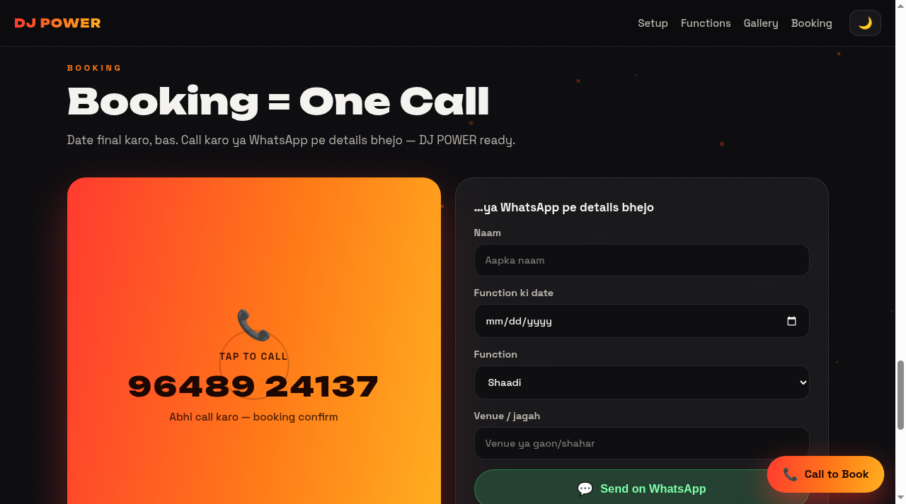
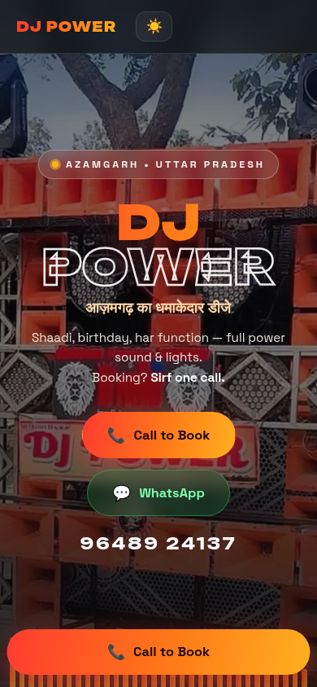
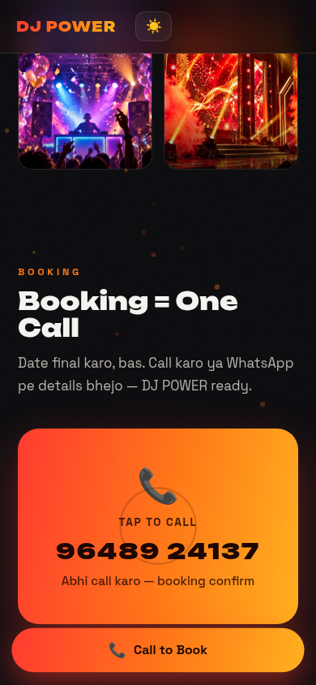

# DJ POWER — Official Website

**आज़मगढ़ का धमाकेदार डीजे** 🔊

Live site: **https://akash991833.github.io/dj-power-website/**

A premium, Gen-Z style one-page website for DJ POWER (Azamgarh, Uttar Pradesh) — shaadi, birthday, har function. Dark-first immersive design with real photos of the actual DJ POWER setup, and a one-tap **Call to Book** booking system.

## Features

- **One Call Booking** — floating "Call to Book" button + tap-to-call card (`tel:`) so customers reach DJ POWER in one tap
- **WhatsApp booking form** — name, date, function type, venue → opens WhatsApp with a ready-made booking message (free, no backend)
- **Dark + Light mode** — full theme toggle, saved across visits
- **Immersive Gen-Z look** — canvas particles, film grain, animated EQ bars, marquee, scroll reveals, Unbounded + Space Grotesk type
- **Real photos** — hero and gallery use actual photos of the DJ POWER setup
- **Mobile + desktop** — fully responsive, designed mobile-first
- **Free hosting** — static site on GitHub Pages, no server, no cost

## Tech

Plain HTML/CSS/JS — no frameworks, no build step.

- `index.html` — single page (Setup, Functions, Gallery, Booking sections)
- `style.css` — theme system, animations
- `app.js` — particles, reveals, theme toggle, WhatsApp form
- `hero.jpg`, `setup-full.jpg`, `street.jpg`, `console.jpg`, `party.jpg`, `stage.jpg` — photos of the real DJ POWER setup

## Booking flow

1. Customer taps **Call to Book** → phone dialer opens with DJ POWER's number
2. Or fills the WhatsApp form → WhatsApp opens with the booking details pre-filled — bas send dabao

## Screenshots

### Desktop

### Mobile

## Run locally

Open `index.html` in a browser — that's it. No install, no dependencies.
